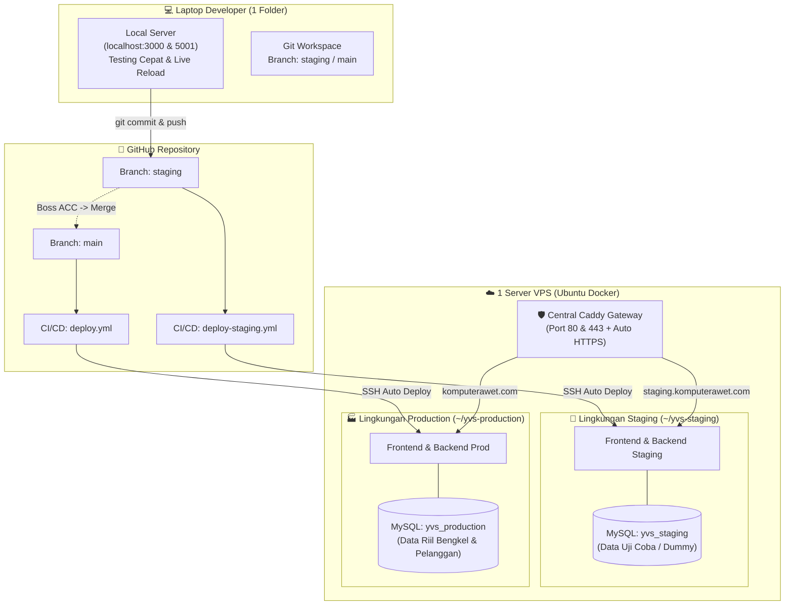
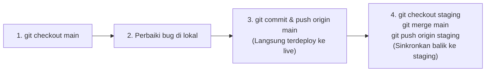

# 📘 Panduan Alur Kerja Development: Local ➔ Staging ➔ Production
> **Serv.io / YVS Platform** — Panduan operasional terpadu pengembangan sistem bengkel komputer.  
> Dirancang dengan standar industri: **Cukup 1 folder project di laptop lokal**, aman untuk data pelanggan, dan otomatis dideploy melalui GitHub Actions.

---

## 🗺️ 1. Peta Arsitektur 3 Lingkungan

Sistem ini membagi siklus hidup software menjadi 3 tier yang berdiri secara independen:



### 📊 Matriks Perbandingan Lingkungan

| Parameter | 💻 Local (Laptop) | 🧪 Staging (VPS) | 🏭 Production (VPS) |
| :--- | :--- | :--- | :--- |
| **Tujuan** | Ngetik kode, buat fitur baru, eksperimen bebas. | Uji coba fitur terpadu, demo ke bos / tim. | Operasional harian bengkel nyata. |
| **Domain / URL** | `http://localhost:3000` | `https://staging.komputerawet.com` | `https://komputerawet.com` |
| **Database** | MySQL Lokal (`localhost:3306`) | MySQL VPS (`yvs_staging` port internal 3306 / host 3307) | MySQL VPS (`yvs_production` port internal 3306 / host 3306) |
| **Sifat Data** | Data dummy bebas hapus. | Data simulasi / skenario pengujian bos. | **Data Riil** (Wajib aman, tidak boleh rusak/hilang). |
| **Cara Deploy** | Jalankan `./run.sh` (Detik itu juga langsung jalan). | Otomatis via Git Push ke branch `staging`. | Otomatis via Git Push / Merge ke branch `main`. |
| **Folder di Laptop** | **1 Folder Saja** (`/run/media/bleu/DATA/dev/yvs`) | Tidak ada folder terpisah (cukup switch branch). | Tidak ada folder terpisah (cukup switch branch). |

---

## 🛠️ 2. Step-by-Step Alur Kerja Harian

### FASE 1: Coding & Eksperimen di Laptop Lokal
> **Tujuan:** Mengembangkan fitur secepat mungkin tanpa menunggu build server/internet.

1. **Pastikan berada di branch `staging`:**
   Buka terminal di folder project laptop Anda:
   ```bash
   git checkout staging
   ```

2. **Jalankan server lokal:**
   ```bash
   # Di Linux / Mac:
   ./run.sh

   # Atau di Windows / Node runner:
   node run.js
   ```
   - Frontend: `http://localhost:3000`
   - Backend API: `http://localhost:5001`
   - Fitur Vite Hot-Module-Replacement (HMR) aktif: setiap Anda menyimpan file (`Ctrl+S`), browser langsung terupdate dalam hitungan milidetik.

3. **Lakukan coding seperti biasa:**
   - Tambah komponen baru, sesuaikan logic, atau perbaiki bug.
   - Uji coba tombol, alur QR code, validasi form di browser Anda.

4. **Verifikasi Build sebelum Push (Wajib):**
   Sebelum melempar kode ke server, pastikan tidak ada typo atau kesalahan sintaks yang merusak build:
   ```bash
   npm --prefix frontend run build
   ```
   *Jika build berhasil (`✓ built in ...`), kode 100% aman untuk dikirim.*

---

### FASE 2: Rilis ke Staging (Untuk Dicek Bos / R&D)
> **Tujuan:** Menampilkan hasil kerja di internet sungguhan (`https://staging.komputerawet.com`) agar klien/bos bisa mencoba langsung di HP atau laptop mereka.

1. **Simpan perubahan ke Git:**
   ```bash
   git add .
   git commit -m "feat(tracking): perbaiki layout mobile dan qr deep link"
   ```

2. **Kirim (Push) ke branch `staging`:**
   ```bash
   git push origin staging
   ```

3. **Otomatisasi CI/CD Berjalan:**
   - GitHub Actions akan otomatis memicu workflow [`.github/workflows/deploy-staging.yml`](file:///.github/workflows/deploy-staging.yml).
   - Server VPS akan:
     1. Menarik commit terbaru ke folder `~/yvs-staging`.
     2. Menjalankan Docker build.
     3. Memperbarui skema database `yvs_staging` secara otomatis.
     4. Me-reload kontainer tanpa downtime.

4. **Kirimkan Link ke Bos:**
   Kirimkan pesan ke bos:
   > *"Halo Pak, fitur pelacakan dan QR code baru sudah saya deploy ke staging: https://staging.komputerawet.com. Silakan dicoba tes scan dan fiturnya."*

---

### FASE 3: Rilis ke Production (Live Bengkel)
> **Tujuan:** Menerapkan fitur yang **sudah disetujui (ACC)** ke sistem operasional kasir, teknisi, dan pelanggan asli.

Setelah bos mereview di staging dan berkata: *"Oke, sudah bagus dan siap dipakai di toko/bengkel"*, lakukan rilis ke Production:

1. **Pindah ke branch `main`:**
   ```bash
   git checkout main
   ```

2. **Tarik perubahan terbaru (jika ada):**
   ```bash
   git pull origin main
   ```

3. **Gabungkan (Merge) fitur dari branch `staging`:**
   ```bash
   git merge staging
   ```
   *(Karena sudah teruji di staging, proses merge akan langsung `Fast-forward` tanpa konflik).*

4. **Push ke Production:**
   ```bash
   git push origin main
   ```

5. **Otomatisasi CI/CD Production Berjalan:**
   - GitHub Actions memicu workflow [`.github/workflows/deploy.yml`](file:///.github/workflows/deploy.yml).
   - Server VPS memperbarui folder `~/yvs-production`.
   - Database `yvs_production` disinkronkan tanpa menghapus data riil pelanggan.
   - Sistem live di `https://komputerawet.com` langsung menggunakan versi terbaru.

6. **Kembali ke branch `staging` untuk tugas berikutnya:**
   ```bash
   git checkout staging
   ```

---

## 🚨 3. Alur Penanganan Bug Darurat (Hotfix Flow)

Jika terjadi kendala mendadak di sistem Live Bengkel (`production`) yang butuh penanganan segera:



Langkah praktis di terminal:
```bash
# 1. Pindah ke branch main
git checkout main

# 2. Perbaiki baris kode yang error, lalu tes sebentar
npm --prefix frontend run build

# 3. Commit dan push langsung ke Production
git add .
git commit -m "hotfix(auth): perbaiki validasi token login"
git push origin main

# 4. SANGAT PENTING: Sinkronkan kembali perbaikan tersebut ke staging agar staging tidak ketinggalan
git checkout staging
git merge main
git push origin staging
```

---

## 💾 4. Aturan Penting Manajemen Database

Agar data pelanggan tidak pernah hilang atau rusak:

1. **Prisma DB Push Otomatis:**
   - Kontainer backend diatur untuk menjalankan `prisma db push` secara otomatis saat booting.
   - Kolom baru atau tabel baru akan otomatis dibuat di MySQL tanpa perlu Anda jalankan query manual di phpMyAdmin / DBeaver.
2. **Aturan Mengubah Kolom:**
   - Jangan pernah menghapus kolom yang sudah berisi data riil pelanggan di production tanpa backup.
   - Lebih baik tambahkan kolom baru (bersifat opsional/nullable) daripada me-rename kolom lama.
3. **Pemisahan Data:**
   - Data akun admin atau tes coba-coba silakan dibuat bebas di `https://staging.komputerawet.com`.
   - Data faktur dan unit servis asli hanya dibuat di `https://komputerawet.com`.

---

## 📋 5. Ringkasan Perintah Cepat (Cheat Sheet)

| Kebutuhan Anda | Perintah yang Dijalankan di Terminal |
| :--- | :--- |
| **Mulai ngoding hari ini** | `git checkout staging && ./run.sh` |
| **Cek status file yang diubah** | `git status` |
| **Tes build sebelum rilis** | `npm --prefix frontend run build` |
| **Kirim update ke Staging (Uji Coba Bos)** | `git add . && git commit -m "pesan" && git push origin staging` |
| **Rilis fitur ke Production (Live)** | `git checkout main && git merge staging && git push origin main && git checkout staging` |
| **Cek log kontainer Staging di VPS** | `docker compose -f ~/yvs-staging/compose.staging.yaml logs backend --tail 30` |
| **Cek log kontainer Production di VPS** | `docker compose -f ~/yvs-production/compose.prod.yaml logs backend --tail 30` |
| **Cek status semua kontainer di VPS** | `docker ps` |

---
*Dokumen ini dibuat otomatis sebagai panduan baku arsitektur Serv.io / YVS.*
