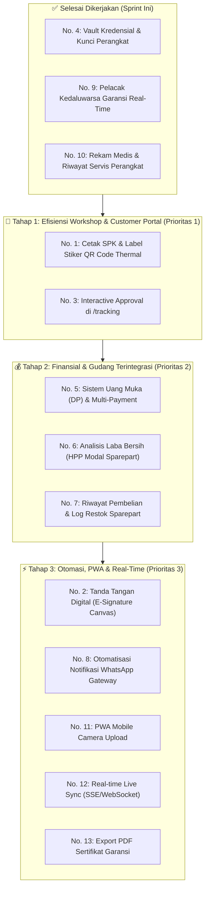

# Serv.io — Blueprint Rencana Pengembangan & Peningkatan Masa Depan (Future Roadmap)

Dokumen ini merupakan panduan arsitektur dan spesifikasi teknis untuk pengembangan lanjutan platform **Serv.io (Sistem Manajemen Pusat Servis & Perbaikan IT)**. 

Dokumen ini mencakup rekapitulasi fitur yang telah diimplementasikan pada sprint ini, serta perincian lengkap seluruh potensi fitur dan peningkatan yang ditangguhkan (*deferred improvements*) untuk sprint mendatang.

---

## 📌 Ringkasan Status Rilis Fitur

| No | Fitur | Kategori | Status | Keterangan |
| :---: | :--- | :--- | :---: | :--- |
| **4** | **Vault Kredensial / PIN & Kunci Perangkat** | Workshop & Keamanan | ✅ **Selesai (Sprint Ini)** | Kolom `tipe_kunci`, `password_perangkat`, masking mata `••••`, copy clipboard, perlindungan privasi pada tracking publik. |
| **9** | **Pelacak Kedaluwarsa Garansi Real-Time** | Garansi & Retensi | ✅ **Selesai (Sprint Ini)** | Kolom `garansi_berakhir_at`, kalkulator durasi otomatis saat diambil, countdown sisa hari/lewat hari, proteksi klaim expired. |
| **10** | **Rekam Medis & Riwayat Servis Perangkat** | Master Data & Medis | ✅ **Selesai (Sprint Ini)** | Count badge `_count.tiket_servis`, modal rekam medis komprehensif di master data perangkat, kartu riwayat servis masa lalu di tiket. |
| **1** | **Cetak SPK & Label Stiker QR Code Thermal** | Fisik Workshop | 📋 *Roadmap Prioritas 1* | Cetak tanda terima fisik (A5/80mm) dan stiker QR code tempel casing unit. |
| **3** | **Interactive Customer Approval di `/tracking`** | Portal Publik & UX | 📋 *Roadmap Prioritas 1* | Konfirmasi persetujuan estimasi langsung via web tracking dengan verifikasi nomor HP. |
| **5** | **Sistem Uang Muka (DP) & Multi-Payment** | Finansial & Kasir | 📋 *Roadmap Prioritas 2* | Dukungan pembayaran DP, sisa tagihan, metode transfer/QRIS/cash pada invoice. |
| **6** | **Analitik Laba Bersih (HPP Sparepart)** | Business Intelligence | 📋 *Roadmap Prioritas 2* | Margin keuntungan real (Biaya Jasa + Selisih Jual-Beli Sparepart), grafik laba bulanan. |
| **7** | **Log Pengadaan & Restok Sparepart** | Inventori & Logistik | 📋 *Roadmap Prioritas 3* | Riwayat audit pembelian suku cadang dari supplier beserta nota dan harga modal. |
| **2** | **Tanda Tangan Digital (E-Signature Canvas)** | Legalitas & SOP | 📋 *Roadmap Prioritas 3* | Tanda tangan serah terima awal (intake) dan pengambilan unit lunas. |
| **8** | **Gateway Otomatisasi Notifikasi WhatsApp** | Otomasi & CRM | 📋 *Roadmap Prioritas 4* | Direct API webhook / worker background message tanpa perlu klik `wa.me` manual. |
| **11** | **PWA & Quick Mobile Camera Upload** | Mobile Teknisi | 📋 *Roadmap Prioritas 4* | Kamera ponsel teknisi langsung upload foto kondisi/QC ke tiket. |
| **12** | **Real-Time Live Push (SSE Engine)** | Kinerja & Real-Time | ✅ **Selesai (Sprint Ini)** | Menggantikan interval polling 3-10 detik pada dashboard & tabel tiket dengan Server-Sent Events instan. |
| **13** | **Export Laporan PDF & Sertifikat Garansi** | Laporan & Dokumen | 📋 *Roadmap Prioritas 5* | Generator PDF resmi siap cetak untuk audit bulanan dan kartu garansi customer. |

---

## 🎯 Detail Spesifikasi Fitur Roadmap Masa Depan

---

### 1. Cetak Surat Tanda Terima Masuk (SPK) & Label Stiker QR Code Unit
- **Tingkat Prioritas:** 🥇 Prioritas 1 (Quick Win & High Impact)
- **Estimasi Effort:** 1 - 2 Hari Kerja
- **Latar Belakang Masalah:**
  Pada bengkel yang menangani puluhan perangkat laptop dan PC setiap hari, unit rawan tertukar di rak antrean servis teknisi. Teknisi harus bolak-balik mencocokkan nomor seri manual dengan data di monitor.
- **Rancangan Solusi:**
  1. **Surat Perintah Kerja (SPK) / Tanda Terima Intake:**
     - Diberikan ke customer saat pendaftaran awal sebagai bukti sah penyerahan unit.
     - Memuat: Logo workshop, nomor tiket, tanggal masuk, data pemilik, keluhan, kelengkapan yang dititipkan (charger, tas, mouse), catatan kondisi fisik awal (hasil checklist intake), dan klausul syarat & ketentuan garansi.
     - Diformat siap cetak ukuran A5 atau kertas thermal kasir 80mm.
  2. **Label Stiker Mini QR Code (Barcode Casing):**
     - Didesain untuk printer label thermal mini (ukuran 50x30mm atau 40x20mm).
     - Menampilkan: QR Code (berisi tautan `https://serv.io/tracking?tiket=SRV-2026-001`), Nomor Tiket, Nama Customer, Merek & Model, dan Tanggal Masuk.
     - Ditempel di bagian bawah laptop / bodi PC. Teknisi cukup memindai QR code menggunakan smartphone atau barcode scanner USB untuk langsung membuka tiket kerja di sistem.
- **Teknologi & Dependensi yang Dibutuhkan:**
  - Frontend: `qrcode.react` (atau `@zxing/library`), CSS `@media print`.
  - Endpoint baru: `/api/tiket-servis/:id/print-spk`.

---

### 2. Tanda Tangan Digital Pelanggan (Digital Signature Canvas)
- **Tingkat Prioritas:** 🥈 Prioritas 3
- **Estimasi Effort:** 2 Hari Kerja
- **Latar Belakang Masalah:**
  Sering terjadi perselisihan (*dispute*) di mana customer mengklaim casing mereka tidak lecet sebelum masuk servis, atau menuduh adaptor/flashdisk hilang di bengkel.
- **Rancangan Solusi:**
  1. Tambahkan komponen interaktif *Signature Pad* (HTML5 Canvas) pada formulir intake saat customer menyerahkan unit di meja kasir. Customer membubuhkan paraf/tanda tangan digital di atas layar tablet/touchscreen kasir.
  2. Tambahkan tanda tangan kedua pada saat serah terima pengambilan unit (*Handover Sign-off*) yang menyatakan bahwa unit telah ditest di depan customer dan diterima dalam kondisi baik.
  3. Tanda tangan disimpan dalam format Base64 / file gambar PNG di folder `uploads/signatures/` dan ditampilkan di bagian bawah SPK dan Invoice.
- **Perubahan Skema Database:**
  ```prisma
  // Tambahan pada model TiketServis:
  signature_intake   String?  @db.LongText  // Tanda tangan serah terima masuk
  signature_handover String?  @db.LongText  // Tanda tangan serah terima kembali
  signed_at          DateTime?
  ```
- **Teknologi:** `react-signature-canvas`.

---

### 3. Interaktif "Setujui / Tolak Estimasi Biaya" di Portal Pelacakan Publik (`/tracking`)
- **Tingkat Prioritas:** 🥇 Prioritas 1
- **Estimasi Effort:** 1.5 Hari Kerja
- **Latar Belakang Masalah:**
  Saat tiket berstatus `menunggu_persetujuan`, customer dapat melihat rincian kerusakan dan estimasi biaya di halaman `/tracking`, namun mereka masih harus menghubungi admin via WhatsApp manual untuk menyatakan setuju atau menolak.
- **Rancangan Solusi:**
  1. Pada halaman `/tracking`, ketika status tiket = `menunggu_persetujuan`:
     - Tampilkan tombol aksi tebal: **[Setujui & Lanjutkan Perbaikan]** dan **[Tolak & Batalkan Servis]**.
  2. Untuk mencegah salah klik atau akses oleh pihak yang tidak sah:
     - Tampilkan modal verifikasi sederhana: *"Masukkan 4 digit terakhir nomor HP Anda untuk konfirmasi"*.
  3. Setelah diverifikasi:
     - Jika Setuju $\to$ Status otomatis berpindah ke `disetujui`, notifikasi tercatat di `ActivityLog`, dan teknisi dapat langsung mulai mengerjakan unit.
     - Jika Tolak $\to$ Status berubah menjadi `dibatalkan` dengan opsi customer memilih alasan penolakan (misal: "Biaya melebihi budget", "Ingin ganti unit baru").
- **Endpoint Baru:**
  - `POST /api/tracking/:nomor_tiket/action`
  - Payload: `{ action: "approve" | "reject", verification_phone: "1088", alasan: "..." }`

---

### 4. Sistem Uang Muka (Down Payment / DP) & Multi-Payment Method
- **Tingkat Prioritas:** 🥈 Prioritas 2
- **Estimasi Effort:** 2 - 3 Hari Kerja
- **Latar Belakang Masalah:**
  Untuk pekerjaan perbaikan berat yang membutuhkan pembelian suku cadang mahal (seperti panel LCD retina, motherboard, baterai original import), bengkel wajib menagih DP sebesar 30%–50% sebelum barang dipesan ke distributor.
- **Rancangan Solusi:**
  1. Perluasan model `Invoice`:
     - `nominal_dp`: Jumlah uang muka yang telah diterima.
     - `sisa_tagihan`: Hasil kalkulasi `total_biaya - nominal_dp`.
     - `metode_pembayaran_dp` & `metode_pembayaran_pelunasan`: Pilihan *Cash*, *Transfer BCA*, *Transfer Mandiri*, *QRIS*, *Debit Card*.
     - `status_pembayaran`: Status enum yang lebih kaya: `belum_bayar`, `sebagian_dp`, `lunas`.
  2. Cetak Kuitansi Pembayaran DP: Kasir dapat langsung menerbitkan kuitansi resmi bukti titip uang muka.
- **Perubahan Skema Database:**
  ```prisma
  // Tambahan pada model Invoice:
  nominal_dp               Float     @default(0)
  sisa_tagihan             Float     @default(0)
  metode_pembayaran        String    @default("Cash") // Cash, Transfer Bank, QRIS
  bukti_transfer           String?   @db.VarChar(255)
  tgl_pelunasan            DateTime?
  ```

---

### 5. Laporan Laba/Rugi & Analisis Margin Keuntungan (Net Profit Analytics)
- **Tingkat Prioritas:** 🥈 Prioritas 2
- **Estimasi Effort:** 2 Hari Kerja
- **Latar Belakang Masalah:**
  Dashboard saat ini hanya mencatat omset pendapatan kotor (*Gross Revenue*). Pemilik bisnis tidak memiliki visibilitas terhadap margin laba bersih karena harga beli modal (*HPP - Harga Pokok Penjualan*) sparepart belum tercatat.
- **Rancangan Solusi:**
  1. Tambahkan kolom `harga_beli` (harga modal) pada tabel master `Sparepart`.
  2. Saat teknisi menggunakan sparepart, catat snapshot `harga_beli_satuan` pada `PenggunaanSparepart` agar histori laba tidak terpengaruh jika harga sparepart di gudang naik di kemudian hari.
  3. Formula Laba Bersih per Tiket:
     $$\text{Laba Bersih} = \text{Biaya Jasa} + \sum (\text{Harga Jual Sparepart} - \text{Harga Modal Sparepart})$$
  4. Visualisasi Dashboard Admin:
     - Kartu KPI: **Total Laba Bersih Bulan Ini** dan **Margin Rata-rata (%)**.
     - Grafik Recharts: Perbandingan tren bulanan *Gross Revenue vs Net Profit*.

---

### 6. Riwayat Pembelian & Log Restok Suku Cadang (Stock Procurement Log)
- **Tingkat Prioritas:** 🥉 Prioritas 3
- **Estimasi Effort:** 1.5 Hari Kerja
- **Latar Belakang Masalah:**
  Saat ini stok sparepart langsung diedit secara manual di tabel tanpa ada jejak audit (*audit trail*): siapa yang menambah stok, dari toko/distributor mana dibeli, berapa nomor surat jalan/faktur pembelian, dan berapa harga modalnya.
- **Rancangan Solusi:**
  1. Buat model baru `RestockLog`:
     ```prisma
     model RestockLog {
       id             Int       @id @default(autoincrement())
       sparepart_id   Int
       supplier_nama  String
       jumlah_masuk   Int
       harga_beli_pcs Float
       nomor_faktur   String?
       tanggal_beli   DateTime  @default(now())
       catatan        String?
       created_by     Int?      // ID Admin yang melakukan input
       
       sparepart      Sparepart @relation(fields: [sparepart_id], references: [id], onDelete: Cascade)
     }
     ```
  2. Setiap kali stok ditambah, sistem otomatis menambahkan baris log dan mengkalkulasi harga modal rata-rata (*Moving Average Cost*).

---

### 7. Otomatisasi Notifikasi WhatsApp Gateway (Direct Background API)
- **Tingkat Prioritas:** 🥉 Prioritas 4
- **Estimasi Effort:** 2 Hari Kerja
- **Latar Belakang Masalah:**
  Tombol WhatsApp saat ini mengandalkan skema tautan manual `wa.me/?text=...` di browser yang harus diklik satu per satu oleh admin/teknisi melalui aplikasi WhatsApp Web.
- **Rancangan Solusi:**
  1. Hubungkan backend dengan service gateway WhatsApp (misal: Fonnte API, Wablas, WhatsApp Cloud API resmi, atau bot Baileys mandiri).
  2. Sistem otomatis mengirimkan pesan WhatsApp ke nomor customer di latar belakang pada kejadian pemicu (*Event Triggers*):
     - **Saat Tiket Dibuat:** *"Halo Kak Budi, perangkat Anda telah diterima di Serv.io dengan No. Tiket SRV-2026-001. Pantau status berkala di https://serv.io/tracking?tiket=SRV-2026-001"*
     - **Saat Diagnosis Selesai:** Notifikasi rincian kerusakan dan tautan persetujuan biaya.
     - **Saat Unit Selesai Diperbaiki:** Pemberitahuan bahwa unit sudah siap diambil beserta total tagihan.
     - **Pengingat H-3 Garansi Habis:** Pesan CRM ramah menginformasikan garansi akan berakhir 3 hari lagi.
  3. Konfigurasi endpoint dan API Token disimpan secara aman di environment backend (`.env`).

---

### 8. PWA (Progressive Web App) & Quick Mobile Camera Upload
- **Tingkat Prioritas:** 🥉 Prioritas 4
- **Estimasi Effort:** 2 Hari Kerja
- **Latar Belakang Masalah:**
  Teknisi bekerja langsung di meja reparasi dengan obeng dan peralatan fisik. Mengambil foto kerusakan/QC menggunakan kamera handphone lalu mentransfernya ke komputer desktop memakan waktu dan menurunkan efisiensi kerja.
- **Rancangan Solusi:**
  1. Konfigurasi Vite PWA (`vite-plugin-pwa`) dengan manifest app icon, tema seluler, dan service worker caching.
  2. Pada log aktivitas tiket dan checklist intake/QC, gunakan input native kamera ponsel:
     ```html
     <input type="file" accept="image/*" capture="environment" />
     ```
  3. Teknisi cukup membuka browser ponselnya, mengambil foto langsung dari kamera smartphone, dan foto otomatis terunggah dan terkompresi ke server Serv.io.

---

### 9. Real-Time Push Sync dengan Server-Sent Events (SSE) / WebSocket
- **Tingkat Prioritas:** 🥉 Prioritas 5
- **Estimasi Effort:** 1.5 Hari Kerja
- **Latar Belakang Masalah:**
  Halaman dashboard saat ini menggunakan teknik interval polling `setInterval(loadData, 3000)` (request ke database setiap 3 detik). Hal ini membebani server dan database MySQL saat jumlah staf bertambah.
- **Rancangan Solusi:**
  1. Implementasikan endpoint Server-Sent Events (SSE) pada Express:
     `GET /api/realtime/stream`
  2. Setiap kali ada perubahan status tiket, pendaftaran unit baru, atau penugasan teknisi, backend menyiarkan (*broadcast*) payload event ke seluruh klien yang terhubung.
  3. Dashboard langsung memperbarui kartu statistik, daftar antrean tiket, dan memutar suara bel notifikasi (*notification chime*) lembut saat ada pelanggan baru masuk.

---

### 10. Generator Laporan PDF Berstandar & Sertifikat Garansi Resmi
- **Tingkat Prioritas:** 🥉 Prioritas 5
- **Estimasi Effort:** 2 Hari Kerja
- **Latar Belakang Masalah:**
  Saat ini fitur ekspor data yang tersedia adalah Excel (.xlsx). Namun untuk kebutuhan pembukuan resmi, klaim asuransi perangkat customer, dan audit bulanan pemilik bisnis, dibutuhkan dokumen PDF bertanda tangan yang rapi dan tidak dapat dimanipulasi.
- **Rancangan Solusi:**
  1. Gunakan library PDF generator (seperti `pdfkit` di backend atau `@react-pdf/renderer` di frontend).
  2. Format dokumen yang disediakan:
     - **Sertifikat Kartu Garansi Serv.io:** Dilengkapi masa berlaku presisi, nomor serial perangkat, dan stempel digital toko.
     - **Laporan Rekapitulasi Keuangan Bulanan:** Memuat ringkasan omset jasa, penjualan suku cadang, dan rincian performa setiap teknisi.

---

## 📅 Matriks Eksekusi & Roadmap Tahapan Pengembangan



---

*Dokumen ini diperbarui secara berkala sesuai dengan evaluasi kebutuhan operasional bengkel servis dan prioritas pengembangan produk Serv.io.*
